<!-- markdownlint-disable MD013 -->

# Event Operations

This guide covers the full event lifecycle in
[Group Dashboard -> Events](/dashboard/group?tab=events ':ignore'): draft creation, configuration,
publishing, delivery-day execution, and controlled retirement.

For scope boundaries and non-event responsibilities, pair this with
[Group Dashboard Guide](group-dashboard.md).

**Sections:**

- [Lifecycle Model](#lifecycle-model)
- [Authorization Model](#authorization-model)
- [Events List: Work Queue](#events-list-work-queue)
- [Add Event: Draft First](#add-event-draft-first)
- [Event Editor Tabs](#event-editor-tabs)
- [CFS Workflow (End to End)](#cfs-workflow-end-to-end)
- [Automatic Meeting Creation](#automatic-meeting-creation)
- [Tickets, Discounts, and Refunds](#tickets-discounts-and-refunds)
- [Attendance, Invitation, and Waitlist Operations](#attendance-invitation-and-waitlist-operations)
- [Publish, Unpublish, Cancel, Delete](#publish-unpublish-cancel-delete)
- [Public Event Result](#public-event-result)
- [Event-Day Checklist](#event-day-checklist)

## Lifecycle Model

Treat event operations as a staged workflow, not one big form submission:

1. Build a complete and trustworthy draft.
2. Publish only when attendee-facing data is ready.
3. Run delivery-day operations (attendance, check-in, communication).
4. Retire intentionally (unpublish, cancel, or delete).

When phase 1 is done well, every downstream step is faster and safer.

## Authorization Model

Event write operations require events write access. This is granted by the group `admin` and
`events-manager` roles, and by the community `admin` and `groups-manager` roles. Read-only roles
can still view event data but cannot change it.

Check-in is a separate permission granted to group `admin`, `events-manager`, and
`check-in-manager`, plus community `admin` and `groups-manager`. A check-in manager can view
events and attendees and process check-ins, but cannot modify event settings or other attendee
state.

When your role cannot perform an operation, the event action controls are disabled in the UI, and
OCG enforces the same permissions on every event change.

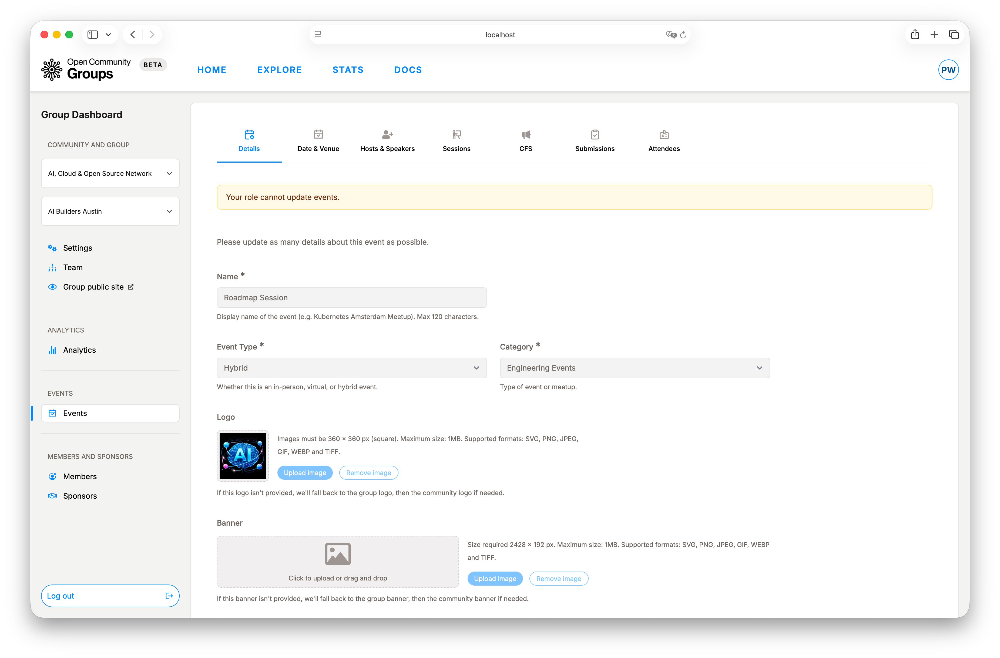

## Events List: Work Queue

[Events](/dashboard/group?tab=events ':ignore') is your organizer queue. `Upcoming events` and `Past events`
help you separate work that needs intervention now from historical cleanup.

From each row, you can:

- Create with [Add event](/dashboard/group?tab=events ':ignore').
- Open edit mode.
- Open the public event page (when available).
- Publish/unpublish.
- Cancel.
- Delete.

Each event is in one of three states: `Draft` while it is still being authored, `Published` once
it is live for public participation, and `Canceled` when it is no longer running. If a canceled
event was published, its public page remains available with canceled-state messaging.

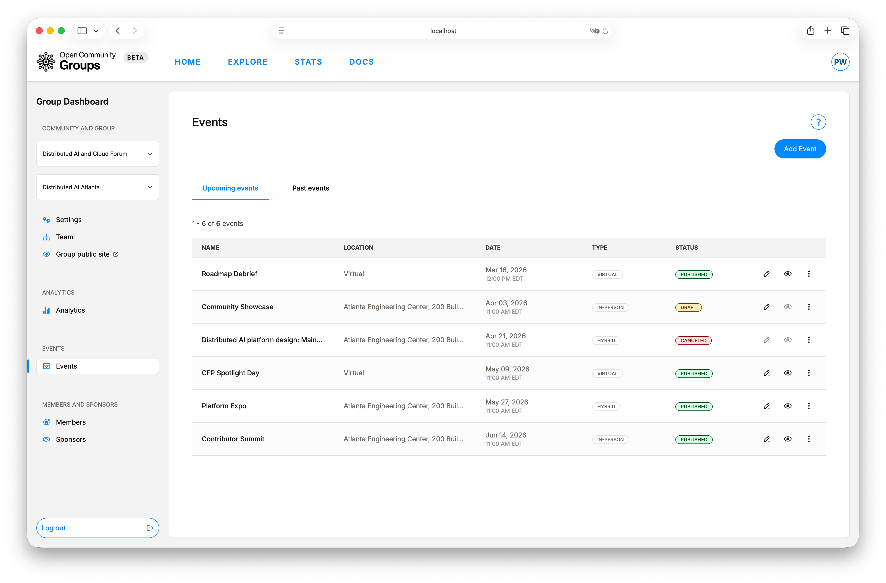

## Add Event: Draft First

The safest pattern is draft-first, publish-second.

Recommended flow:

1. Click `Add Event`.
2. Optionally copy an earlier event to reuse structure.
3. Complete each editor tab.
4. Save. The first save opens the new draft's update page so you can keep editing.
5. Publish only after a full quality pass.

Save keeps you on the event editor. After the first save, later saves stay on that update page.
Publish from the editor stays on the editor. Publish and unpublish from the Events list stay on
the list. Cancel still returns to the Events list.

Copying is intentionally partial so stale logistics are not carried forward:

?> After copying an event, run a quick logistics sweep before publishing.
Time-bound and meeting-specific fields are intentionally not carried forward.

- Start/end dates are cleared.
- Registration window dates are cleared.
- Sessions are not copied.
- Label names and colors are copied as new labels for the new event.
- Meeting links are not copied.
- Some older host/speaker fields may need manual cleanup.

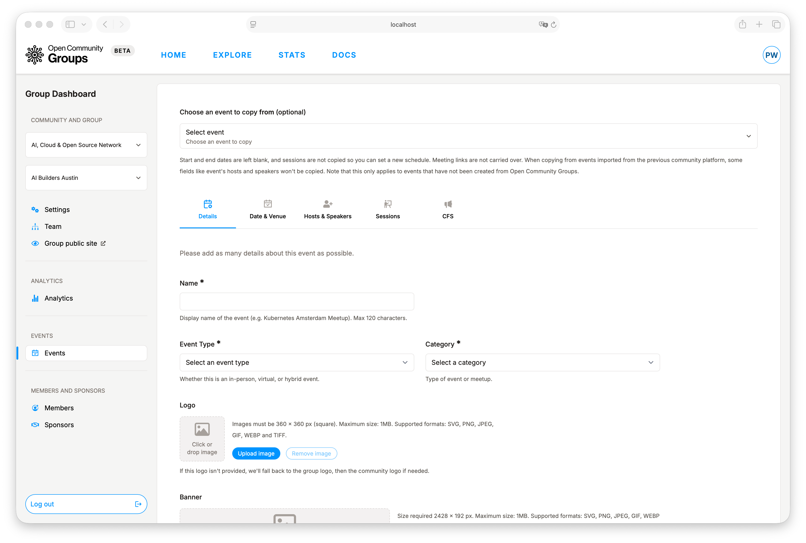

## Event Editor Tabs

The editor groups its tabs by event lifecycle, so you can move from identity and schedule, to
registration, to the program, to people, and finally to follow-up. The sidebar shows each group
under a heading, and the compact section selector on smaller screens shows the same groups.

| Group | Tabs |
| --- | --- |
| Event | `Details`, `Date & Venue`, `Co-hosts`, `Contributors` |
| Registration | `Tickets`, `Questions` |
| Program | `Labels`, `CFS`, `Submissions`, `Sessions` |
| People | `Attendees`, `Requests`, `Waitlist` |
| Follow-up | `Surveys`, `Analytics` |

The add page shows only the authoring tabs, in the same order: `Details`, `Date & Venue`,
`Co-hosts`, `Contributors`, `Tickets`, `Questions`, `Labels`, `CFS`, and `Sessions`. Review tabs
such as `Submissions`, `Attendees`, `Surveys`, and `Analytics` appear once the event exists.
`Requests` and `Waitlist` appear while their feature is enabled or rows remain. `Surveys` is
hidden for canceled events.

`Next` moves to the following tab in this order, across groups.

### Details

In this tab, you define attendee-facing identity and enrollment posture: name, event type,
category, description, branding assets, registration toggle, tags, and optional links.

Event category options come from the defined community's
[Event Categories](/dashboard/community?tab=event-categories ':ignore') tab.

Publish readiness checks in this tab:

- Name, type, category, and description are complete and clear.
- Branding is consistent with group/community standards.
- Registration policy matches expected demand.

Ticketing is configured in the `Tickets` tab. `Ticket Types`
define tier names, public or invitation-only availability, seat counts, and
date-based price windows. `Event Currency` and `Discount Codes` apply only to
paid-capable events.

These are the ticketing rules to keep in mind:

- Every event has at least one ticket type. New events begin with a free,
  public `General Admission` tier with 500 seats.
- Free-only events require no payment provider, group recipient,
  currency, or discount codes.
- Any positive current or future price window makes the event paid-capable,
  including inactive and invitation-only tiers.
- Multiple ticket types can exist on the same event.
- Early-bird pricing is modeled as multiple price windows on the same ticket type.
- Events automatically derive total capacity from ticket seat counts. The last
  ticket type cannot be removed.
- Public tiers support direct enrollment, approval requests, or per-tier
  waiting lists according to event mode.
- Invitation-only tiers are disclosed only to the recipient of an assigned
  offer.
- Positive prices require either Stripe payment configuration with a matching
  group recipient, or an external payment URL when the group has opted into
  [external payments](group-dashboard.md#external-payments) and saved the
  legal name of the organization collecting them.
- External paid events skip the Stripe recipient and tax-rate checks. OCG does
  not calculate tax for them and treats prices as tax-inclusive. They still
  require an in-person or hybrid event with a complete venue.
- Every paid hybrid ticket must include physical admission. Its description may
  also promise virtual access, but it must not describe a paid tier as
  virtual-only.

Deployments upgrading legacy RSVP events automatically create a free, public
`General Admission` tier when an event has no ticket inventory. Existing finite
capacity is preserved or raised to cover occupied seats; previously unlimited
events receive 500 seats.

If your group is not payment-ready through Stripe and has not opted into
external payments, keep every price window at zero. Complete
[Payments Setup](payments-setup.md) or enable external payments in
[group settings](group-dashboard.md#external-payments) before configuring a
positive price.

?> Accepted community admins with verified email addresses who haven't turned off
`Paid event setups` receive an email when a non-test paid event or paid recurring series is
created, and whenever an existing event becomes both non-test and paid-capable.

Waitlist control also lives here:

- `Waitlist enabled` is an explicit event toggle.
- Waiting lists are tracked separately for each sold-out public tier.
- Increase or decrease capacity by changing ticket-type seat counts. A tier's
  seat count cannot be reduced below its current allocation.
- Waitlist cannot be combined with invitation review.
- If capacity is full and waitlist is off, the public page shows the event as sold out.
- If capacity is full and waitlist is on, people can join that tier's waiting
  list instead of starting checkout.

### Date and Venue

This tab controls delivery constraints:

- Timezone, start, and end.
- Optional registration open and close dates.
- Recurrence for creating linked copies of a new event.
- Venue data for in-person/hybrid events.
- Online event details for virtual/hybrid events.
- 24-hour reminder toggle.

Timezone should be set first, then date/time. That avoids accidental scheduling drift and keeps
CFS windows aligned with the intended audience clock.

?> Set timezone first, then start/end timestamps, to avoid accidental schedule drift.

Registration windows are optional, but when configured they become the source of truth for
attendee-facing registration:

- `Registration Opens` controls when attendees can self-register, get tickets, request tickets,
  join the waitlist, or submit registration-question answers. It cannot be after the event start
  time.
- `Registration Closes` controls when those actions stop. It cannot be after the event start time.
  When both fields are set, it must be after `Registration Opens`.
- If only an open time is set, registration stays open until the event starts.
- If only a close time is set, registration is open immediately and closes at that time.
- Public event pages and notification templates show the configured window.
- Organizer offers are an override. Invitees can accept and answer required
  registration questions outside the public window.
- Active ticket checkout holds are also an override for completion only. Registration close stops
  new checkout starts, but attendees already holding a ticket can finish checkout and required
  registration questions until the hold expires.
- Organizers can accept pending invitation requests and reissue expired approval
  offers outside the public registration window until the event is past or
  canceled. Rejecting a request still works.
- Automatic waitlist promotion stops while registration is closed.

When `Send Event Reminder` is enabled, OCG sends reminder messages about 24 hours before start
time.

When adding a new event, recurrence can create multiple linked events at once:

- `Just once` creates one event.
- `Weekly` creates additional events on the same weekday as the selected start date.
- `Every two weeks` creates additional events on the same weekday every other week.
- `Monthly` creates additional events on the same ordinal weekday, such as the third Monday.

For recurring events, set `Additional Events` to the number of extra linked events to create.
The maximum is `12`. OCG creates each occurrence as a separate individual event, sharing one
series identifier, and shifts event dates, registration windows, CFS windows, sessions, ticket
windows, and discount windows by the same schedule offset. Each occurrence gets its own copy of
the event labels, and its sessions use that copy. Monthly recurrence skips months that do not
contain the same ordinal weekday.

After creation, each occurrence has its own event page, editor, attendees, submissions, sessions,
tickets, and operational state. `Publish`, `Unpublish`, `Cancel`, and `Delete` can target the
whole linked series, but editing event content is intentionally one event at a time.

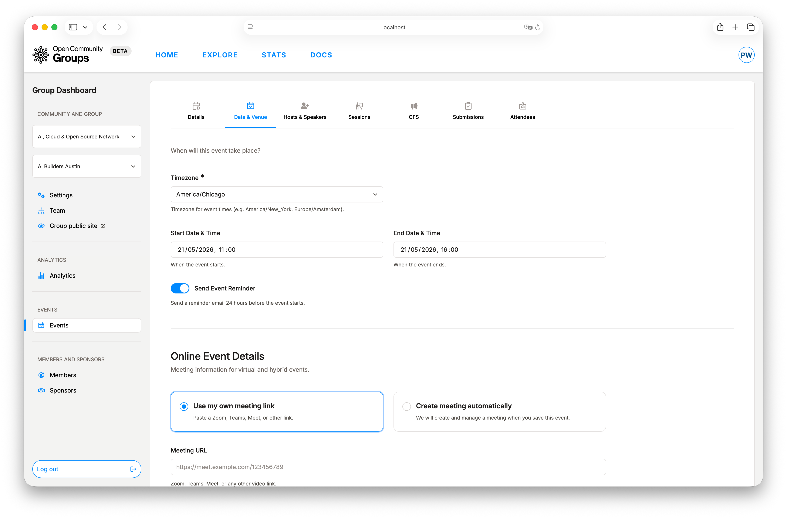

### Co-hosts

Co-hosts credit other groups, including groups in other communities, as partners of the event.
Co-hosting is only about visibility and credit: your group keeps managing and operating the event,
and co-host groups get no access to its editor, attendees, tickets, payments, check-in, speakers,
or meetings.

In this tab, you pick a community, then search its active groups and add them to the event. Each
selected group shows its current state: `Pending` until its admins respond, `Approved` once they
accept, or `Inactive group` when the group can no longer co-host. Saving the event sends one
invitation email to the admins of each newly selected group, and removing a group notifies its
admins. For a recurring series created with co-hosts, every occurrence gets its own invitation,
each co-host group receives one combined email, and each occurrence is approved separately.

- Co-hosts must be set up, and must respond, before the event can be published.
- While the event is published, the co-host selection is read-only. Changing it requires
  unpublishing the event, which keeps existing approvals, but the event cannot be published again
  until every newly added group responds. Try to finish co-host setup before publishing so you
  do not have to take a live event offline.
- You can add again a group that rejected, canceled, or was removed. It receives a new invitation
  and must respond again.
- If co-hosts changed since you opened the editor (for example, a co-host responded), saving your
  co-host changes fails with a message asking you to reload. Saves that do not change co-hosts are
  not affected.
- Canceling or deleting the event ends every pending or approved co-hosting and notifies the
  co-host admins. Groups that had approved stay credited on a canceled event's page.
- Copying an event never copies its co-hosts.

The editor preview shows a `Co-hosts` box with the `Pending` or `Approved` state of each selected
group. Only approved co-hosts are shown on the public event page.

### Contributors

In this tab, you manage event-level people and sponsor attribution. Sections appear in the same
order as on the public event page: `Speakers` (event-level speakers plus a read-only list of
session-level speakers), `Hosts`, `Organizers`, and `Sponsors`. Hosts and speakers can be any user
account on the site, organizers come from the group team, and sponsors come from reusable sponsor
records.

Use event hosts for people who should be explicitly highlighted as running the event program.

This is where attendees understand who is running, organizing, and presenting the program.

Organizers are listed in the public event page's `Organizers` section:

- New events start with the accepted group team, in team order. You can add or remove people on
  both the add and update pages; new people are appended to the end of the list, and the list
  cannot be reordered.
- Only accepted group team members can be added, and the organizer search lists only them. People
  who leave the team stay listed on existing events until an editor removes them, but cannot be
  added again unless they rejoin. The editor asks for confirmation before removing them.
- An event created without an organizers list, such as a request that omits the organizers
  selector, lists the accepted group team.
- Copying an event copies its organizers who are still on the group team. When none remain, the
  new event keeps the group team default.
- The organizer list is stored with each event, so later group team changes do not update existing
  events.
- An empty organizer list hides the public `Organizers` section.

The public event page always shows a `Contact organizers` button at the end of its
`About this event` section. Its messages go to the group team inbox, whoever is listed as an
organizer.

People without a full name in their profile are not listed on the public event page or in the
editor preview, whatever their role. If no organizer has a full name, the public page hides the
`Organizers` section.

Existing hosts, organizers, and speakers can also receive badges from their row menus. The
`Award badge` buttons next to the `Hosts` and `Organizers` headings award every current host or
organizer, and the speakers bulk action awards the deduplicated set of event-level and
session-level speakers. Save contributor and session changes before awarding. For the complete
contributor award flow, see [Group Badge Management](badges.md#group-badge-management).

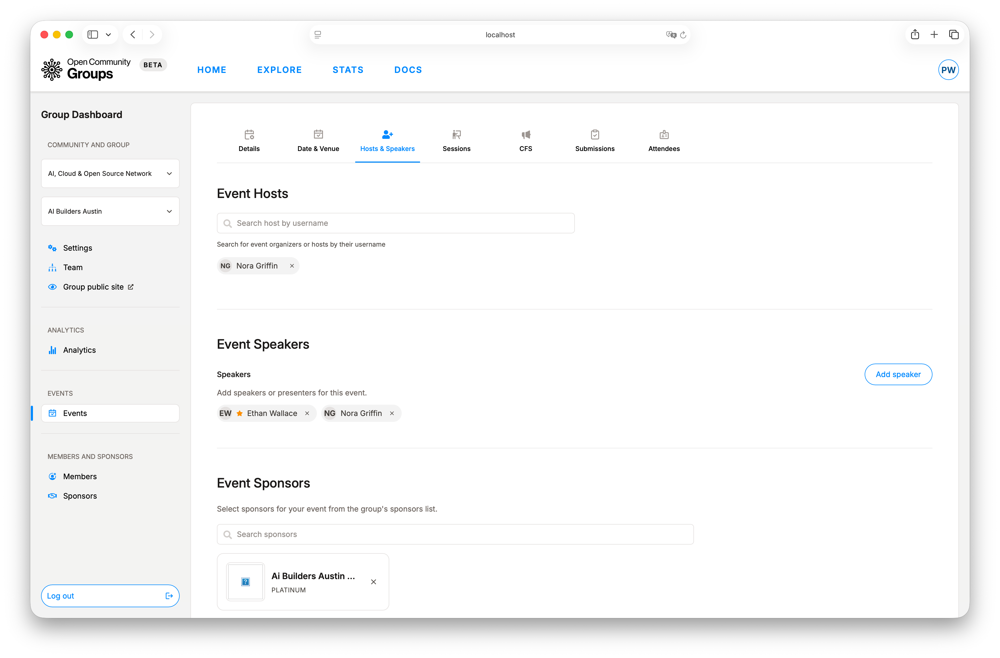

### Questions

Use the `Questions` tab to define registration questions for attendees. Supported question types
are free text, single select, and multi select. Select questions use organizer-defined options,
and each question can be marked `Required`. Only required questions must be answered; optional
questions can be skipped.

Questions appear when the answers are needed:

- With a ticket request.
- Before RSVP or checkout.
- When an organizer or waitlist offer is claimed.

Joining a waiting list does not collect answers. Mark a question `Required` when you need that
answer at request, RSVP, checkout, or claim time. Ticket-request answers are available from the
`Requests` tab through `View answers`. Confirmed-attendee answers are on the `Attendees` tab.

Registration questions are copied when you create an event from an existing event. After attendees
submit answers, or while active checkout holds exist, the questions become read-only so existing
attendee answers and in-progress checkouts cannot drift away from the question definitions.

Invitation review also lives here:

- `Require Invitation Approval` changes public ticket actions to
  `Request ticket`.
- Approval cannot be combined with waitlist, but it can be combined with free
  or paid ticketing.
- Public ticket requests preserve the selected tier. A fully private
  event accepts a generic request without disclosing private tiers.
- Pending requests do not reserve seats. Accepting a ticket request creates a
  time-limited offer when capacity and payment readiness allow it.
- A generic private request requires the organizer to assign an active
  invitation-only tier during acceptance.
- Accept pending requests while the event is still active. New public requests
  stop outside the registration window. Rejecting a request still works.
- Use `View answers` on the `Requests` tab to review answers submitted with a
  ticket request before accepting or rejecting it.
- Disabling invitation review is blocked while pending requests exist.
- Accepted requests receive a time-limited offer that must be claimed. Free
  offers complete inside OCG; positive prices continue to hosted checkout. If
  ticket sales end before the deadline, the stored offer price can still be
  claimed.

Brand inheritance in event details mirrors the group model: if the event logo is not provided,
OCG falls back to the group logo, then the community logo; if the event banner or mobile banner
is not provided, OCG falls back to the group banner, then the community banner.

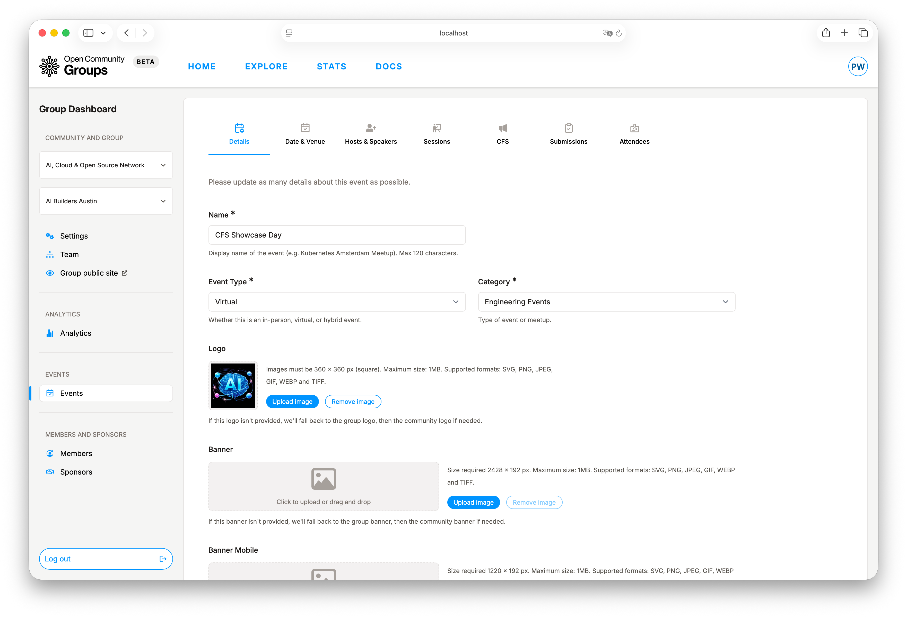

### Labels

Labels are the event's shared set of tracks, topics, or themes. Sessions and CFS submissions both
use them, and you can manage them whether or not CFS is enabled. Labels are public: they appear on
session chips on the event page and in the CFS submission form.

- An event can have up to `200` labels, each with a name of up to `80` characters and a color
  from the palette.
- Label names must be unique within the event and cannot be blank.
- Renaming or recoloring a label updates every session and submission that uses it.
- Delete a label with its trash button. Deleting a label removes it from every session and
  submission that uses it.

?> Renaming a label updates every session and submission that already uses it.

### CFS

This tab configures speaker intake: enabling or disabling CFS, setting open/close timestamps, and
writing the CFS description shown on the event page. Speakers and reviewers pick submission labels
from the event's set, managed in the `Labels` tab.

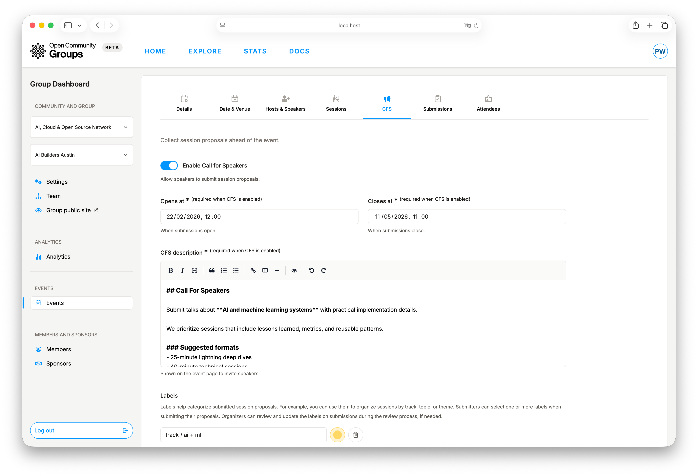

### Sessions

Sessions turns approved content into an actual agenda. Here you create agenda rows with time
bounds, keep session times inside the event start/end, and link approved CFS submissions into the
schedule.

Each session can carry up to `10` labels from the event's label set. Labels appear as chips on the
session in the editor, in the preview, and on the public event page. When you link an approved CFS
submission, the session starts with that submission's labels; you can change them before saving.
After that, session and submission labels are independent: changing one does not change the
other.

This tab is usually most useful once review outcomes are clearer and your schedule is taking
final shape.

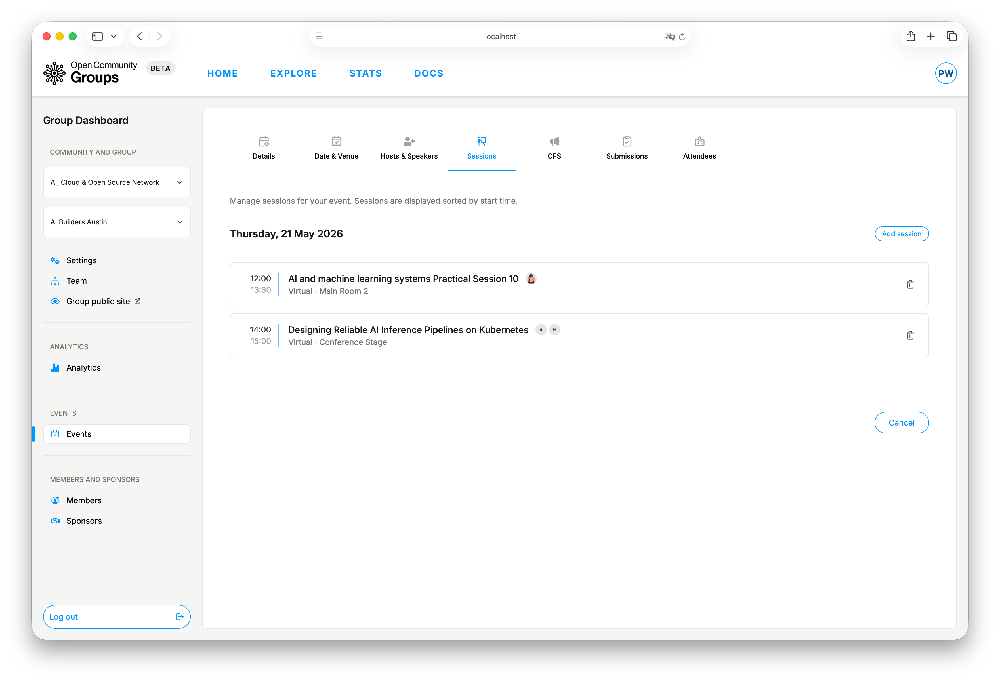

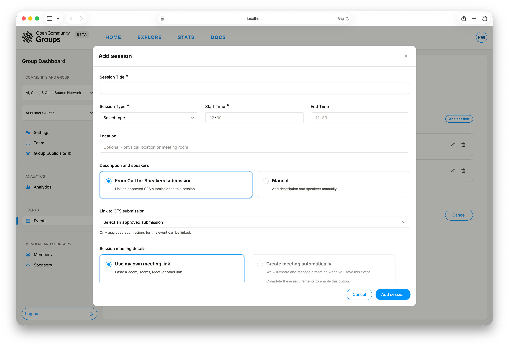

## Tickets, Discounts, and Refunds

Public tickets are attendee-self-service from the event page.

Public ticket flow:

1. Attendee selects a ticket type.
2. Optional discount code is entered on the event page.
3. OCG creates a short seat hold.
4. Free tickets are completed immediately.
5. A positive final price either redirects to hosted payment checkout or, for
   external paid events, opens the organizer payment page and holds the seat
   until the organizer marks the purchase paid or the confirmation deadline
   passes.
6. Attendance is created immediately for free tickets, after the payment
   provider confirms payment for Stripe tickets, or after an organizer marks
   an external purchase paid.

Paid ticketing is available only for in-person or hybrid events with a complete
physical venue, plus either a configured fiscal sponsor or the group's external
payments opt-in. Virtual events remain free-only. Every paid hybrid ticket
includes physical admission; it may also include virtual access, but cannot be
virtual-only. While any active or future positive price exists, OCG rejects
venue, event-kind, currency, sponsor, or tax changes that would make Checkout
ineligible.

Stripe events select one ticket-tax mode in the `Tickets` tab: automatic Stripe
Tax, manual Stripe Tax Rates, or no tax collection. External paid events do not
offer this control; OCG does not calculate tax for them. Automatic Stripe Tax uses
the professional-event admission classification for in-person tickets and
hybrid tickets that include physical admission. Manual-tax events select one
or more active Tax Rates owned by the fiscal sponsor's connected Stripe
account; the selected rates must all match the event's inclusive or exclusive
tax display. Paid manual-tax events require at least one selection. No-tax
events hide the tax display control, never show `+ tax`, and require Stripe to
return zero tax during payment reconciliation.

Stripe remains authoritative for Tax Rate names, percentages, jurisdictions,
activity, and inclusive/exclusive behavior. OCG stores the selected identifiers
on the event, snapshots those identifiers when a paid purchase starts, and
stores the authoritative subtotal, aggregate tax, and total returned after
Checkout. Replacing a fiscal sponsor is blocked while an upcoming published
paid manual-tax event exists. Draft manual-tax events must reselect rates after
the sponsor changes.

Ticket and discount data model:

- Ticket types are event-level, can be mixed free and paid, and can be public
  or invitation-only.
- Each ticket type can have one or more date-range price windows.
- Discount codes are event-level and support fixed-amount or percentage discounts.
- Discount codes can be limited by time window, remaining uses, or total available uses.
- Remaining uses are consumed by active holds and active purchases, then restored when a hold
  expires, a free ticket is released, or a refund is finalized.

Refunds follow a request-and-review model. Paid attendees do not use `Leave event`; they use
`Request refund` from the public event page instead. Organizers can review refund requests in
`Event -> Attendees` or the group dashboard `Refunds` tab and approve or reject them. Refund
requests must be submitted before the event starts, though organizers can still approve or reject
a request later if it was submitted before the start time. Organizers can also select
`Cancel attendance and refund` on a confirmed paid attendee without waiting for an attendee
request. For Stripe purchases, both paths queue a full provider refund; paid attendance and its
capacity remain active until the refund is confirmed or manual recovery is recorded, then OCG
marks the attendance as canceled. For external purchases, both paths ask the organizer to confirm
that the money was returned outside OCG, then mark the purchase refunded and cancel the attendance
immediately; the refunds table labels those rows `External`. Rejecting an attendee request leaves
the attendee and ticket unchanged. A rejection requires a reason; the attendee sees the same
reason in their notification, on the event page, and in `My Events`. Approval notes remain
optional and organizer-only. Both dashboard views show refund progress until the refund completes
or needs intervention.

The fiscal sponsor funds the full refund from its connected account. If Stripe
reports insufficient sponsor funds, OCG leaves the refund pending and visible
in the group dashboard `Refunds` tab. OCG does not send a dedicated
administrator notification or advance platform money. A successful refund
returns the remaining application fee to the sponsor and creates a credit note
linked to the same customer refund. Partial customer refunds are not
supported.

Canceling the whole event is another way a refund begins. OCG immediately cancels active attendance,
completes free-ticket refunds locally, expires pending external holds and emails those attendees
not to send payment, marks completed external purchases refunded locally, and queues every Stripe
paid ticket for a full provider refund. Unpublishing does not refund anything, but it also expires
pending external holds and sends the same do-not-pay email.
The event remains canceled even if a provider attempt later needs retry or manual recovery.
After arranging an out-of-band refund for a terminal provider failure, an organizer with events
write access can complete that recovery from the group dashboard `Refunds` tab. Other roles see the
recovery action disabled with an explanation of the requirement.

Refund requests, approvals, rejections, and completed refunds are all written to audit logs.
Organizers are notified when attendees request refunds. Attendees are notified when a rejection
is recorded, including the rejection reason, or an approved or automatic paid refund has
completed.

Capacity is released immediately for a canceled free ticket. Paid capacity
remains allocated through refund-requested, provider-pending, and recovery
states, then releases after successful finalization or recorded manual
recovery. Reconciliation then allocates available inventory to the oldest
eligible queue entry.

OCG does not subscribe to or process connected-account dispute events. The
fiscal sponsor monitors and handles disputes entirely in Stripe, including
evidence, balances, and any application-fee, invoice, or tax action. OCG sends
no dispute notifications and does not change attendance automatically;
organizers use the normal attendance controls for any separate attendance
decision.

### Attendance, Invitation, and Waitlist Operations

The dashboard separates confirmed attendees from people waiting for a seat or organizer approval.

On the organizer side, the tabs work like this:

- `Attendees` shows confirmed attendees plus organizer-created offer history.
- `Requests` shows one row per requester: the request, its requested or assigned
  tier, and the requester's newest approval offer.
- `Waitlist` shows one row per person: the FIFO queue position for a queued
  user, or the newest waiting-list offer for a person no longer queued.
- `Requests` appears while invitation review is enabled, and `Waitlist` appears
  while the waitlist is enabled. When either setting is turned off, its tab
  remains until its list is empty, so organizers can still review past requests
  or remaining waitlist entries.
- `Requests` opens filtered to pending requests while invitation review is
  enabled, and shows every status once it is turned off.
- Lapsed waiting-list or approval outcomes (expired, declined, canceled) are not
  listed once the person is enrolled another way, such as an organizer
  invitation, a registration, a purchase, a new request, or a queue entry.
- `Attendees`, `Requests`, and `Waitlist` keep search, filter, sort, and pagination state together
  while you refine the table.
- Canceling an event notifies attendees, speakers, and waitlisted users.
- Accepting or rejecting an invitation request is written to the audit log.
- `View answers` on the `Requests` tab shows registration answers submitted with a ticket request.
- Sending, canceling, accepting, or rejecting an organizer-created event invitation is written to
  the audit log.

Capacity changes drive automatic waitlist behavior:

- If an attendee leaves and inventory becomes available, OCG reconciles the
  oldest eligible waiting-list entry while registration is open.
- If you raise a ticket tier's seat count, reconciliation offers the new
  inventory to that tier's queue before direct checkout or organizer
  invitations use it.
- A queue head that cannot currently receive an offer because payment setup or
  current pricing is unavailable keeps first position. Later users and direct
  checkout cannot skip that person.
- If you later disable the waitlist, OCG stops accepting new waitlist sign-ups. People who were
  already on the waitlist remain queued and may still be promoted automatically when registration is
  open and attendee spots open up, for example after a cancellation or a capacity increase.
- Reconciliation creates a time-limited offer for each promoted user. It never
  moves someone directly from the waiting list into confirmed attendance.
- Attendee cancellation notifications are guaranteed: if OCG cannot queue the
  required cancellation notification, the attendance cancellation is not saved.
- Organizer invitations bypass public approval and registration windows, but
  never capacity or public-tier queue priority.
- Active offers reserve capacity until their displayed deadline. The claim
  window is at most 24 hours. Organizer invitations and approval offers are
  shortened by event start before the event begins, or by event end after it
  starts. Waitlist offers are also shortened by the registration close time.
  Approval and organizer-invitation claims keep a stored price so they remain
  claimable after ticket sales end. Fresh or undiscounted waitlist claims
  still need a current price window.
- Expiry, decline, or organizer cancellation releases the reservation and runs
  reconciliation. Declined or expired waitlist recipients lose that queue
  position and are not automatically requeued.
- Expired approval offers and organizer invitations can be reissued when the
  recipient remains eligible. Waiting-list offers cannot be manually reissued.
  `Invite` on a lapsed-offer row in `Waitlist` sends an organizer invitation, and
  the person is then managed from `Attendees`. `Invite` on a queued person sends
  an organizer invitation unless reconciliation first promotes them from the
  queue, in which case they receive a waiting-list offer and stay in `Waitlist`.
  A later invitation that ends does not restore the waiting-list row.

On the member side, these actions trigger notifications:

- Accepting an approval request creates a claimable offer.
- Claiming a free organizer offer confirms attendance and sends the normal
  event confirmation. A positive offer price starts hosted checkout or, for
  external paid events, creates an external payment hold.
- Joining the waitlist sends a waitlist confirmation notification.
- Leaving the waitlist sends a waitlist removal notification.
- Waitlist promotion sends an offer notification with the tier, displayed
  price, claim link, and exact deadline.
- Confirmation notifications caused by completing free organizer offers or
  completing pending registration questions are guaranteed: if OCG cannot
  queue the required notification, the attendance change is not saved.

Paid attendance behaves differently in a few ways:

- Paid tickets require payment before attendance is created.
- Checkout can only start while registration is open. If registration closes before a pending
  payment is completed, an active ticket hold can still be fulfilled until the hold expires.
- If checkout is interrupted, the public event page and user dashboard show
  `Continue to checkout` (Stripe) or `Open payment page` (external) while the
  hold is active.
- External holds last until the organizer-confirmation deadline shown on the
  attendee row. Match the incoming transfer to the attendee's payment reference
  (the purchase ID) and use `Mark payment received` before that deadline; ask
  attendees in the payment instructions to pay early enough for you to review.
  After expiry the seat, discount, and answers are released, the attendee is
  emailed, and `Mark payment received` is rejected. Recover by inviting the
  attendee or asking them to register again.
- Attendees can use `Cancel checkout` before payment completes to release the hold and choose a
  different ticket or discount code.
- Free ticket attendees can still leave the event themselves.
- Paid attendees request refunds instead of leaving directly.

### Submissions

This tab is the reviewer control center. From here you can filter by labels, sort by submission
time, rating count, or stars, open the review modal, and update status with reviewer feedback.

The reviewer-facing statuses are:

- `Not reviewed`
- `Information requested`
- `Approved`
- `Rejected`

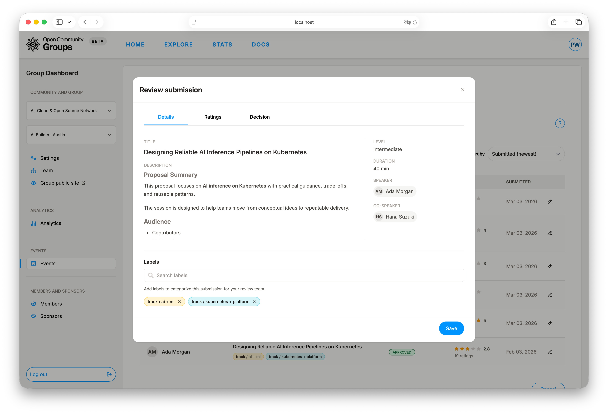

#### Rating submissions

Reviewers can rate each submission on a 1–5 star scale with an optional comment. Ratings
are internal only — speakers never see ratings or rating notes. The review modal shows a
dedicated `Ratings` tab where you can set, update, or clear your rating. Other reviewers'
ratings and comments are visible in the same tab so the team can compare assessments.

The submissions list displays the average rating and total rating count for each entry.
Use the sort options (by stars or rating count) to surface the strongest or most-reviewed
submissions quickly.

When a reviewer update requires notifying the speaker, OCG sends a submission update message.

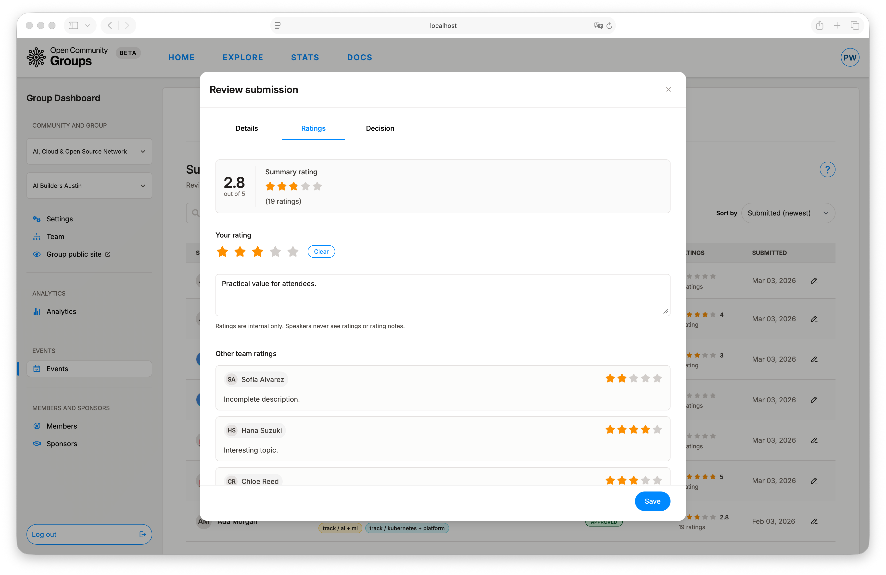

### Attendees

This tab supports delivery-day execution. From here you can:

- Review the attendee list and enrollment timing.
- Run manual check-in.
- Open the QR scanner from desktop with `Scan Attendee Codes`.
- Cancel confirmed attendance for future active events, queueing a full refund for Stripe paid
  tickets or confirming an out-of-band return for external paid tickets.
- Mark external payments received once the transfer arrives.
- Open the attendee actions menu to invite attendees with an assigned ticket
  type.
- Award badges to all attendees, checked-in attendees, selected attendees, or one attendee.
- Send all-attendee or selected-attendee operational emails.
- Download the attendee list or attendee answers as CSV. Exports include
  confirmed attendees only and support events with up to 10,000 confirmed
  attendees; larger events are rejected with a message stating both counts.

Use [Check-In](/dashboard/group?tab=check-in ':ignore') for the primary event-day workflow. Select
the community and group above the event list when working on mobile, then select an event, allow
camera access, and scan each attendee's personal QR code. The scanner stays open, shows the attendee
name and ticket, distinguishes a new check-in from a duplicate scan, and then resumes automatically.
On desktop, the Attendees tab also offers a `Scan Attendee Codes` button that opens the same scanner in
place and updates the attendee table when it closes if any attendees have been scanned. It requires
check-in access and is disabled for canceled, unpublished, or past events. Use the attendees
table toggle as the manual fallback when a camera or QR code is unavailable. In both flows, the
person must have confirmed attendance.

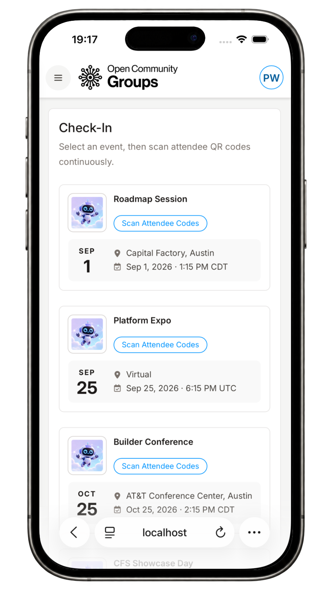

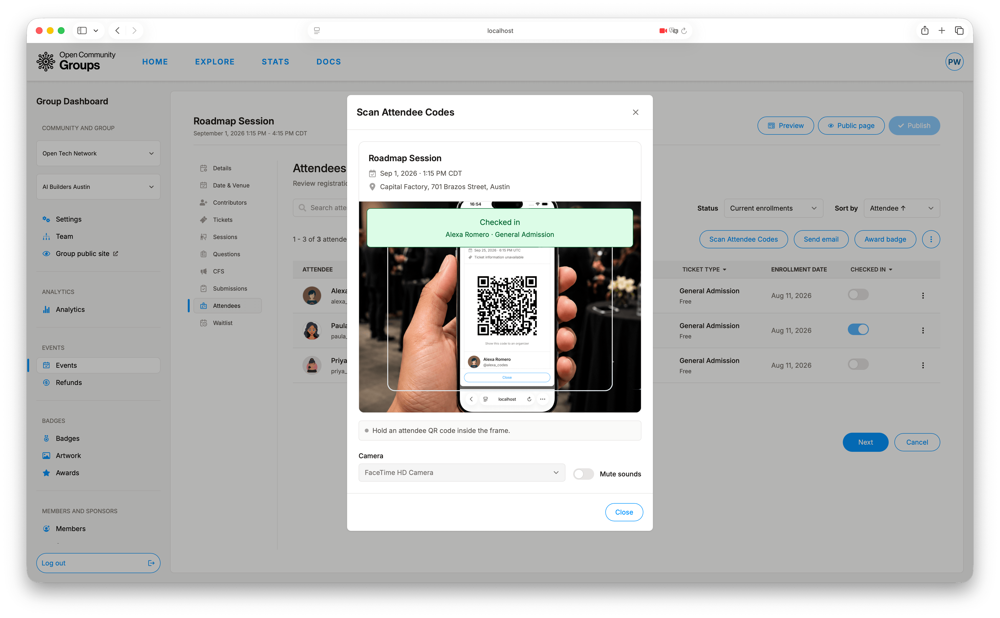

The `Award badge` menu opens the badge picker for the chosen attendee set. Selection mode keeps
chosen attendees while you change table filters, sorting, or pages. For eligibility, duplicate
award, and revocation behavior, see
[Group Badge Management](badges.md#group-badge-management).

`Cancel attendance` is available from confirmed attendee row actions for future, active events
with free tickets. OCG marks free attendance as canceled immediately, notifies the attendee, and
can promote the next waitlisted user when a seat opens. For paid tickets, the action is labeled
`Cancel attendance and refund`. For Stripe purchases it queues a full refund and keeps attendance
active until refund confirmation; the refund completion notification is sent after attendance is
canceled and any released capacity is reconciled. For external purchases it asks you to confirm
that the money was returned outside OCG, then cancels the attendance and notifies the attendee
immediately. Canceled attendance remains in the event history rather than being deleted.

The attendee actions menu contains event-level attendee actions and exports. `Invite attendee` is
available when you have event write access. Invitations require an active,
currently priced tier with capacity. You can select a registered platform user
or enter an email address. For new invitees, use their LF account primary email
because LF SSO activates the email invitation by that address. For existing
users, select the registered platform user when possible; LF-linked accounts
can keep logging in after an LF email change because OCG reconciles them by LF
SSO identity. Active offers show their tier, state, and deadline and can be
canceled. Expired organizer invitations can be reissued when eligible.

The same attendee actions menu includes two CSV exports. `Attendees list CSV` exports one row per
confirmed attendee with these columns:

- Name, company, and title.
- Whether the attendee was manually invited.
- Enrollment date (UTC).
- Payment method (`Stripe`, `External`, or `Free`), amount, and paid-at time.
- For external purchases: payment deadline, who marked the payment received,
  and the payment details note.

`Attendees list CSV (including answers)` adds one column per registration question. Row actions
also include `View answers` when an attendee has submitted registration answers.

CSV exports are safe to open in spreadsheets: any cell, headers included, that starts with `=`,
`+`, `-`, `@`, or a control character such as a tab or line break gets a leading `'`, so
spreadsheets show it as text instead of evaluating it as a formula.

Pending holds appear with different statuses depending on the payment path: Stripe holds show
`Checkout pending`, external holds show `Payment pending`. The row actions menu for a
`Payment pending` attendee offers `Mark payment received`. The confirmation modal shows the
attendee, ticket, amount, and payment reference (the purchase ID) and accepts an optional details
note such as a bank reference. Marking a payment received is not reversible; if you confirm by
mistake, use `Cancel attendance and refund` to correct it.

The attendees table can be searched by attendee identity and visible profile details, including
company and title. It can also be sorted by attendee name or enrollment date, and filtered by
enrollment status, check-in status, title presence, or ticket type. The `Enrollment status` selector
groups broad views separately from exact statuses. `Current enrollments` includes confirmed,
checkout-pending, payment-pending, invitation-pending, and registration-pending enrollments.
`Enrollment history` includes canceled attendance plus canceled, declined, and expired
invitations. Select an exact status or `All enrollments` when you need a narrower or complete
audit. Check-in filters apply only to confirmed attendees. Canceled events open on
`All enrollments` so organizers can see the full audience and paid-refund progress.

The invitation requests table can be sorted by requester or request date, filtered by request status
or title presence, and reset to `All` statuses when you need to audit accepted and rejected requests.
Row actions include `View answers` when the requester submitted registration answers.
The waitlist table can be sorted by entry name or joined date and filtered by title presence; the
queue column still shows the FIFO promotion order. An exhausted transient refund can be retried from
its attendee row; terminal provider failures remain visible for operator recovery.

`Send email` in this tab sends operational updates to attendees who haven't turned off
`Messages from event organizers` or muted the group.
Organizers can send to all eligible attendees, including confirmed attendees and attendees who still
need to complete registration questions, or enter email selection mode to choose eligible attendees
directly from the table. Eligible attendee rows also include `Send email` for starting with that
attendee selected. The email form includes a required `Subject`, defaults it to
`{group name}: {event name}`, and sends the message body as plain text.

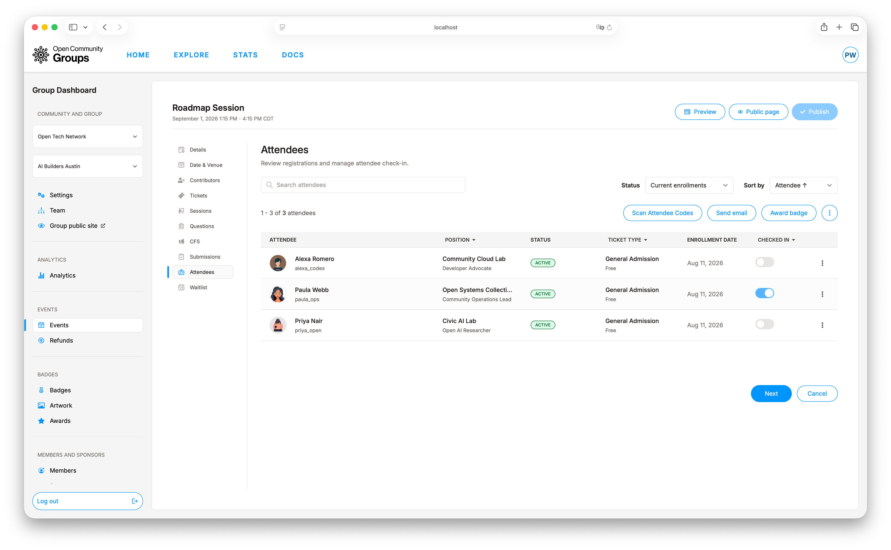

### Surveys

The `Surveys` tab collects feedback from attendees after the event ends. Surveys use the same
question types as registration questions: free text, single select, and multi select, each of
which can be `Required`. An event can have up to `10` surveys, and each survey up to `30`
questions. The tab is hidden for canceled events.

Use `Add survey` to open the survey form in place, and `Back to surveys` or `Cancel` to return to
the list. New surveys start as drafts, and drafts never email anyone, so you can prepare them before
the event. The form has:

- `Title`, shown to attendees in the email and in their dashboard.
- `Introduction`, optional plain text shown above the questions, up to 500 characters.
- `Anonymous responses`, on by default.
- `Audience`: `Confirmed attendees`, or `Checked-in attendees only`.
- `Opens at`, an optional opening time. Leave it empty to open the survey when the event ends.
- `Closes at`, an optional closing time. Leave it empty to keep the survey open until you close
  it.
- The questions.

Times use the event timezone. If you leave the form, or the page, with unsaved survey changes, OCG
asks you to confirm before discarding them. If someone changed the survey since you opened it,
saving fails with a message asking you to review it and try again.

The surveys list header shows how many surveys the event has out of the `10` allowed. The list shows
each survey's title, audience and anonymity, state, question count, responses, and closing date.
Draft and scheduled surveys also show when they open, for example `Opens May 10, 2099 11:00 AM
CEST`, or `Opens once the event has a date` while the event has no date. Its row actions open the
results, download the responses CSV, edit the survey, change its state, and delete it.

#### Survey states

| Status      | Meaning                                                                    | Row action      |
| ----------- | -------------------------------------------------------------------------- | --------------- |
| `Draft`     | Being prepared. Never visible to attendees and never sends email.          | `Mark ready`    |
| `Scheduled` | Ready, waiting to open.                                                    | `Back to draft` |
| `Open`      | Accepting answers.                                                         | `Close`         |
| `Closed`    | Closed manually, or past its `Closes at` time.                             | `Reopen`        |

A ready survey opens at the later of its `Opens at` time and the event end, so it never opens
before the event ends. It stays scheduled while the event is unpublished or has no date.

The row actions work as follows:

- `Mark ready` (draft): the survey needs at least one question, and a `Closes at` time, when set,
  must be in the future and after the survey opens. While any of these is missing, the button is
  disabled and the row shows why under the `Draft` badge. The confirmation shows how many
  attendees are currently in the audience and when the opening email is sent: on a date, once the
  event has a date and ends, once the event is published, or now. For test events, the
  confirmation says that no email is sent. If the
  event is rescheduled after the confirmation is shown, marking ready fails and asks you to review
  the new opening time.
- `Back to draft` (scheduled): only available before the opening email is sent and before anyone
  answers.
- `Close` (open): attendees can no longer answer or edit their answers.
- `Reopen` (closed): accepts answers again, without sending a new email. When the `Closes at` time
  has passed, edit or clear it first.

When a button is unavailable, hovering it shows why.

When a survey opens, OCG sends one email, once, to the attendees in its audience who have a
verified email address and have not turned off `Event surveys` emails or muted the group. People
who join the audience later, for example by checking in after the survey opened, can still answer
the survey, but get no email. Test events never send survey emails. Attendees answer surveys from
the [Surveys](user-dashboard.md#surveys-event-feedback) section of their dashboard, where they can
edit their answers until the survey closes, and the email opens the survey there directly.

#### Anonymity and locked settings

Answers are always stored per attendee, so each attendee has one response that they can edit. For
anonymous surveys, organizers only see aggregated results and answers without names. Identified
surveys also show each respondent's name, company, and title in the results and the CSV.
Identities never appear in the `Attendees` tab.

An anonymous survey stays anonymous once it opens or its opening email is sent, because attendees
were told their answers are anonymous. From then on, `Anonymous responses` is read-only and a note
below it explains why. An identified survey can still be made anonymous until it has responses.

Once a survey has responses, its questions, audience, and anonymity are read-only, and an amber
notice explains why. The title, introduction, and dates can still be updated. The lock stays even
if the respondents later delete their accounts.

#### Results and CSV

Results open in place, with a `Back to surveys` link. The header shows the responses as eligible
respondents over the attendees currently in the audience, for example `12 / 40 (30%)`, plus the
total number of stored responses when attendees who are no longer in the audience also answered.
It shows `-` while nobody is in the audience. The `Summary` view also shows three cards: the
responses, the audience and anonymity, and the closing date in the event timezone.

- `Summary` lists the questions in order. Select questions show each option's selections and share
  of respondents. Free-text questions show a compact preview of the first 10 answers, oldest first,
  with long answers shortened to a few lines. The button below the preview, for example
  `View all 42 answers`, opens every answer to the question in full in a dialog, 10 per page, with
  `Prev` and `Next` buttons and a search box that matches the answer text. The search also
  works on anonymous surveys, because answers never show who gave them.
- `Individual` lists the respondents in a table, 20 per page and oldest response first, with each
  respondent's name, title, and company, their ticket type, how many questions they answered (for
  example `7 of 10`), and when they submitted, plus when they last edited their answers. The search
  box matches respondent names, usernames, companies, and titles. Selecting a row, by clicking it or
  pressing Enter, opens that respondent's answers in a dialog, with `Prev` and `Next` buttons
  that move through the respondents matching the search. It is only available for identified
  surveys.
- Anonymous surveys with fewer than 5 responses show a notice that their answers may still
  identify the attendees who gave them.

`Download CSV` exports one row per response and one column per question. Anonymous survey exports
contain the submitted and updated dates (UTC) and the answers; identified survey exports also
include the respondent's name, company, and title. Exports support up to 10,000 responses and
50 MB of answers; larger surveys are rejected with a message stating both sizes. Cells are
protected against spreadsheet formulas like every other CSV export.

#### Deleting surveys

`Delete` removes the survey and all its responses, even when it has responses. The confirmation
states how many responses will be deleted, and deletion cannot be undone.

Every role that can read the group dashboard can view the surveys list, the survey settings and
results, and download CSVs. Adding, editing, changing the state of, and deleting surveys require
events write access; read-only roles see a notice, the survey form in read-only mode, and disabled
`Add survey`, status, and `Delete` buttons.

Every survey change is recorded in the group audit log; responses are not.

### Analytics

The `Analytics` tab of the event editor shows how the event page attracts visitors, how they turn
into registrations and check-ins, and how attendees respond to surveys. Every role that can read the group dashboard can view it, and only
the group that owns the event sees it. Analytics are cached for up to an hour, so recent activity
can take that long to appear.

The tab reports counts only. It never shows revenue, refunds, discount amounts, or any other
monetary figure.

The summary cards show:

- `Page views`: raw loads of the event page across all days, not unique visitors.
- `Registrations`: attendees currently confirmed, including manual invitations.
- `Fill rate`: registrations divided by the event capacity, or `-` without a capacity.
- `Conversion`: registrations divided by all page views. It is approximate, is not capped
  at 100%, and shows `-` while the event has no views.
- `Check-in rate`: checked-in registrations divided by registrations, shown once the event ends.

Below the summary cards, the tab groups its figures into `Traffic`, `Registrations`, `Tickets` (paid
events only), `Audience`, `Check-ins` (once the event ends), and `Surveys` (once a survey is not a
draft).

#### Daily charts

The daily charts run in UTC days from the publication day to the event's last day, or to today
while the event is still current. Counters are kept per UTC day, so the first and last days cover
the full UTC day. Dashed markers show the publication, the configured registration open and close,
the event reminder, announcements (the 50 most recent), and the event start. Hover a marker to see
its time in the event timezone.

Unpublishing an event clears its publication date, so republishing starts the daily charts again
from the new publication day. When the event is not published, has no recorded publication date,
or was published after it ended, an explanation replaces the daily charts and the other figures
stay available.

#### Traffic

- `Total page views`, `Attributed views`, and `Unattributed views` split all page views by whether
  they came from links with UTM values the group accepts (see
  [UTM Tracking](group-dashboard.md#utm-tracking)), with their share of all page views.
- `Page views per day` stacks views by the top three UTM sources of the charted days, `Other` for
  the remaining sources and campaign-only links, and `Untagged` for views without recorded UTM
  attribution. Totals still count every view; views recorded before the publication day, for
  example during an earlier publication, and views recorded after the event's last day are noted
  below the chart.

Traffic sources report the attributed page views across all days. Views whose source, medium, or
campaign is empty are shown as `Not specified`, and shares are computed against all page views.

- The share chart splits all page views into the top three sources, `Other`, and `Untagged`.
- `Views by value` shows the top eight values of the selected parameter (`Source`, `Medium`, or
  `Campaign`), plus `Not specified` and `Other` for the remaining values.
- The combinations table lists the top 10 source, medium, and campaign combinations by views, with
  their share and first and last days. Sorting applies to these rows, and a final row summarizes
  the remaining combinations.

Page views and attributed views are counted separately, so attributed views can exceed the total.
When that happens on any day or overall, the tab marks attribution as unavailable: the shares are
hidden, the daily page views show raw totals, and the counts are shown as recorded.

#### Registrations

- `Registrations per day` stacks registrations by the ticket type of each attendee's latest purchase
  that holds a seat. Registrations without one appear as `Unknown ticket type`, or as
  `Registrations` on free events. Registrations are dated by when they were created, which is
  approximate.
- The fill curve shows cumulative registrations per UTC day against the capacity. It starts from
  the registrations created before the publication day.
- The funnel compares page views, registrations, and, once the event ends, checked-in attendees.
- `How attendees registered` splits current registrations by the path that admitted them: `Direct`
  registrations and purchases, `Approved request`, `Waiting list`, and `Organizer invitation`
  offers. Attendees without a recorded path appear as `Unknown`.
- The enrollment state cards show attendance cancellations, the waiting list size, and invitation
  requests by status.
- The admission offers cards count the offers sent from each origin, by outcome. Pending offers
  whose deadline has passed count as `expired (deadline passed)`.

Enrollment figures describe the current state of the event, not its history.

The fill curve also shades the registration window. The window opens at the registration start, or
at the publication when none is set. It closes at the registration end; when only a registration
start is set it closes at the event start, and otherwise it stays open. The close is then cut short
at the event end and at the current time. Opens taken from the publication, windows without a
configured close, and cut-short closes are drawn with a dashed border and named in the label.

#### Tickets

Paid events add seat usage per ticket type: seats sold (purchases that hold a seat), seats reserved
(checkout holds and admission offers in progress), and seats remaining of the total. Ticket types
without seats show `No seats configured`. Discount codes show their redemptions, counting purchases
that still hold a seat, and the redemptions still available.

#### Audience

- `New attendees` and `Returning attendees` split registrations by whether the attendee was
  confirmed for an earlier event of the same group. Canceled, deleted, and test events do not
  count. Events without a start date show `-`.
- `Joined during registration` counts people who joined the group inside the registration window,
  and how many of them registered. The window is shown below the cards in the event timezone.
- Single- and multi-select registration questions list their current options by selections, most
  selected first, with each option's count and share of respondents. The 10 most selected options
  are shown, and a button reveals the rest. Multi-select percentages use respondents and can add up
  to more than 100%. Free-text answers are not shown.

#### Check-ins

After the event ends, the check-ins chart shows arrivals in 15-minute intervals, or hourly intervals
for spans longer than three days, in the event timezone. It covers check-ins from six hours before
the start to six hours after the end; check-ins outside that span are counted in a note.

#### Survey responses

The surveys summary lists every survey of the event that is not a draft, in creation order, with
its state, the attendees in its audience who responded, and its response rate. The total number of
stored responses is added when attendees who are no longer in the audience also answered. The rate
shows `-` while nobody is in the audience.

`Overall response rate` combines the open and closed surveys, weighting each one by its audience:
it divides the respondents of those surveys by the attendees in their audiences. Counts are per
survey, so an attendee who answers several surveys counts in each one, and like the rest of the
tab they are cached for up to an hour. The summary has no links; use the `Surveys` tab to see the
results.

## CFS Workflow (End to End)

CFS spans organizer setup, speaker submission, and review loop. Treat it as one connected system.

1. Organizer configures CFS in the event editor.
2. Organizer publishes the event.
3. Speaker prepares reusable proposals in
   [User Dashboard -> Session proposals](/dashboard/user?tab=session-proposals ':ignore').
4. Speaker submits from the event page CFS modal.
5. Organizer reviews in [Group Dashboard -> Event -> Submissions](/dashboard/group?tab=events ':ignore').
6. Speaker tracks outcomes in
   [User Dashboard -> Submissions](/dashboard/user?tab=submissions ':ignore').
7. Approved submissions are scheduled in `Sessions`.

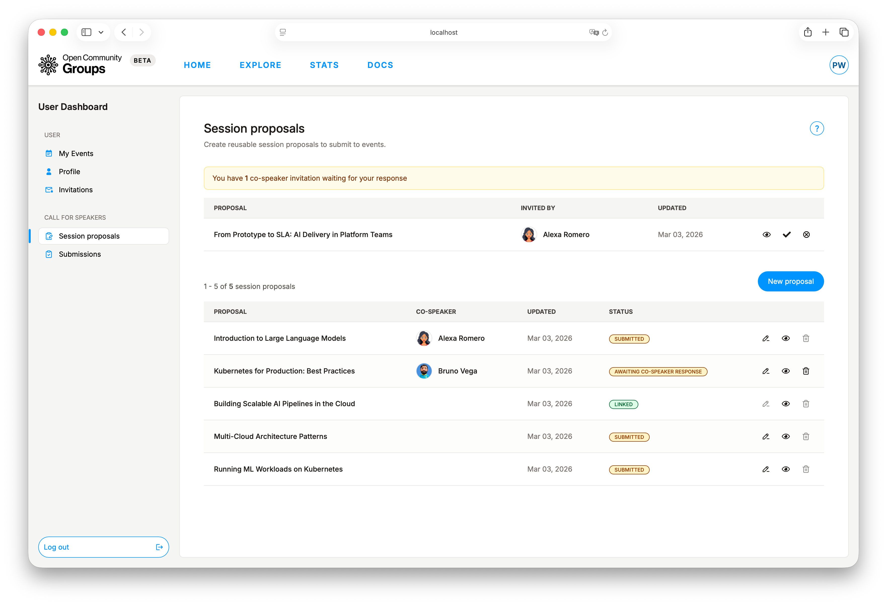

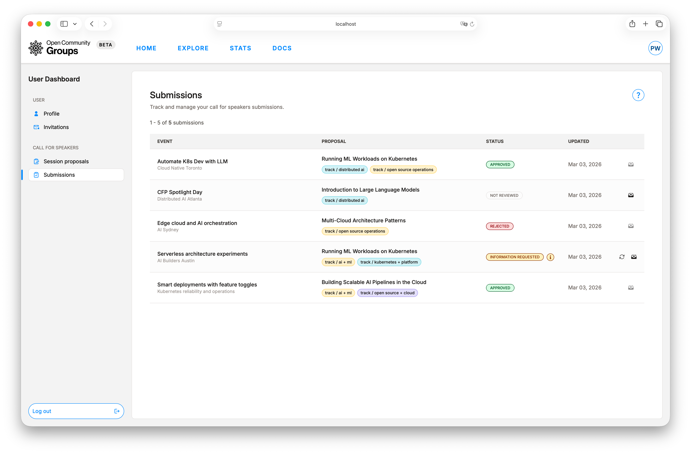

To submit, these requirements must be met:

!> CFS submission requires a published event, enabled/open CFS, and an eligible proposal.
Duplicate proposal submission to the same event is blocked.

- Event must be published.
- CFS must be enabled.
- CFS window must be open.
- Proposal must be eligible for submission.
- Duplicate submission of the same proposal to the same event is blocked.
- Labels must belong to that event's label set.

The review loop works in both directions: `Information requested` asks the speaker for changes
before re-review, `Resubmit` is used after the requested changes are addressed, and `Withdrawn`
is speaker-initiated and typically ends active review.

Every review-side change that should reach the speaker is sent as a submission update message.

For submitter-side perspective, see [User Dashboard Guide](user-dashboard.md).

## Automatic Meeting Creation

Automatic meetings are configured in `Date and Venue -> Online event details`.
You can either use your own manual meeting link or let OCG create/manage a meeting automatically.
Manual meeting, recording, and event social links must be absolute HTTP or
HTTPS URLs. Other URL schemes and protocol-relative URLs are rejected.

How automatic mode works:

- Choose `Create meeting automatically`.
- Select provider (currently `Zoom`).
- Optionally add host emails for coordination.
- Leave `Record meeting` enabled when OCG should ask the provider to record automatically, or
  turn it off when the event should not be recorded.
- Save the event.
- Publish the event to trigger meeting creation.
- Wait for sync; join link/password appear once ready.
- Meetings are automatically ended when the configured end time is reached.

Requirements for automatic mode:

!> Automatic meetings are supported only for `virtual` and `hybrid` events and require valid
schedule/capacity constraints. Manual and automatic meeting modes cannot be used together.

- Event type is `virtual` or `hybrid`.
- Start and end are set, with end after start.
- Duration is within provider limits (5 to 720 minutes).
- Event capacity is set.
- Capacity does not exceed configured provider participant limit.
- Manual meeting links are not used at the same time.

Important limitations and behavior:

!> Switching meeting modes can replace or remove meeting details.
Constraint violations can disable automatic mode until fixed.

- In-person events cannot use automatic meetings.
- Due to current technical limitations, host controls are not available in
  automatically created Zoom meetings.
- Switching automatic to manual can remove auto-created meeting details.
- Switching manual to automatic can replace existing manual links.
- Event and session recording links for automatic meetings can be replaced later
  with processed uploads hosted elsewhere.
- `Record meeting` controls whether automatically created Zoom event and session meetings request
  cloud recording.
- Zoom can send multiple raw recording URLs when participants join before or
  after the main meeting. Review the raw URLs and copy the correct one into the
  final public recording URL field, or use a processed upload.
- Event and session recordings are not public by default. Enable
  `Publish recording publicly` to show the final public recording URL.
- After an automatic meeting or session has started, OCG keeps an already synced provider meeting
  settled instead of re-queueing provider updates for a past start time.
- Schedule or type changes can disable automatic mode if constraints are no longer met.
- Saving an event whose event or session automatic meeting falls outside the provider duration
  limits is rejected until the schedule is adjusted or automatic mode is disabled.
- If sync fails, meeting errors surface in the editor until resolved.
- In deployments without automatic-meeting support, only manual meeting URL fields are available.

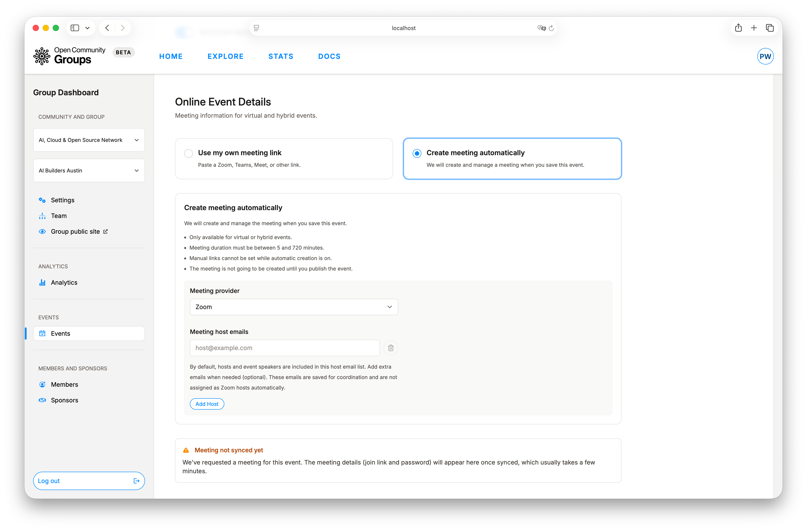

## Publish, Unpublish, Cancel, Delete

Each of these actions serves a different intent. `Publish` makes the event publicly available,
while `Unpublish` hides it without changing its canceled state. `Cancel` marks the event as not
proceeding while keeping an already published page available as canceled, and `Delete`
permanently removes it from normal operations.

Cancellation is irreversible. Its confirmation explains that active attendees will be canceled,
free tickets will be closed locally, and eligible paid purchases will be refunded. Stripe purchases
are queued for a full provider refund, while external purchases are marked refunded locally for
the organizer to settle outside OCG.
Unpublishing does not cancel attendance or start refunds. Deleting does not start refunds either:
future events must be canceled first, and deletion stays disabled while checkout, refund, or refund
recovery work is unresolved. Unused never-published drafts and completed past events can be deleted
without cancellation.

Notification behavior differs per action:

!> `Publish` and `Cancel` can notify large participant sets.
`Unpublish` and `Delete` do not send broad attendee updates in this flow.

- `Publish` on a future unpublished event can notify group members/team members, the members and
  team members of approved co-host groups, and listed speakers. Each person receives one email per
  event.
- `Cancel` on a future published event notifies attendees, speakers, and waitlisted users.
- Series `Publish` and `Cancel` actions aggregate affected events into grouped notifications
  instead of sending one email per event. Aggregate notifications include links to the affected
  events, but do not attach individual calendar files.
- Rescheduling a future published event can notify attendees and speakers when the start or end
  time changes by at least 15 minutes. Waitlisted users are not included in reschedule notices.
- `Unpublish` and `Delete` do not send broad attendee updates in this flow.
- `Cancel` and `Unpublish` both expire pending external payment holds and send
  those attendees a targeted email asking them not to send payment.

For `Publish`, `Cancel`, and event-editor updates that require publish,
cancellation, or reschedule notifications, the notification handoff is guaranteed: if OCG cannot queue
the required notifications, the event change is not saved. A later payment-provider refund failure
does not reverse an event cancellation; it remains visible for retry or recovery.

Automatic meetings follow these actions too: `Publish` triggers creation/sync for configured
automatic meetings (event and session meetings), while `Unpublish`, `Cancel`, and `Delete`
trigger removal/sync for them.

An event cannot be published while any co-host invitation is still pending. The editor `Publish`
button stays disabled with a `Waiting for N co-host(s) to respond` tooltip, and publishing a whole
series is rejected while any of its occurrences has a pending co-host. An occurrence whose co-hosts
have all responded can still be published on its own.

If an event belongs to a recurring series, `Publish`, `Unpublish`, `Cancel`, and `Delete` ask
whether to apply the action to only the selected event or the linked series. Series cancellation
targets only occurrences that are not completed or already canceled. Series actions are applied
atomically: either every selected event is updated, or none are.

Other event edits remain individual-event operations. Updating details, dates, venue, online
meeting configuration, hosts, speakers, sponsors, sessions, CFS settings, tickets, discounts, or
attendee settings changes only the event you are editing, even when it belongs to a recurring
series.

Use the least destructive action that matches your operational goal.

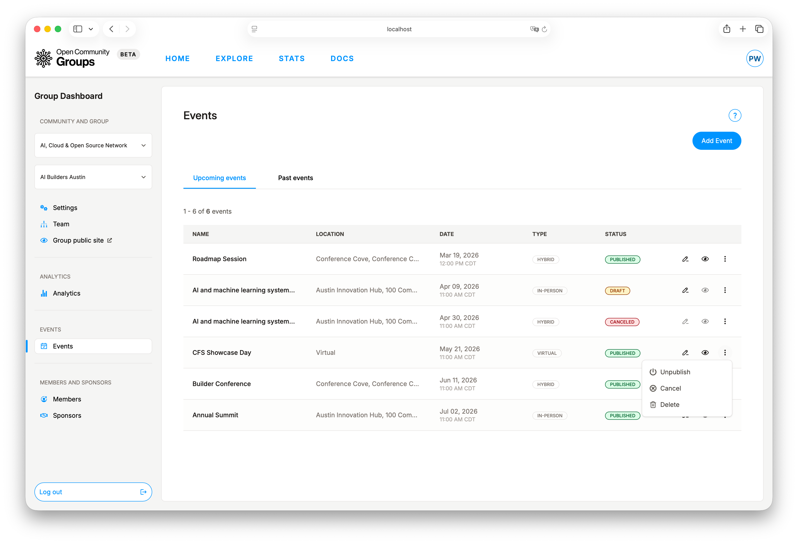

## Public Event Result

The public event page is the delivery surface of all organizer decisions: enrollment controls, logistics,
CFS visibility, and final agenda experience. You can reach it through [Explore](/explore ':ignore').

Approved co-hosts appear in a `Co-hosts` box on the event page, linking to each co-host group,
and in a `Co-hosted with` line on event cards. Co-hosted events are also listed on each co-host
group's page.

For attendee/member perspective, see [Public Site Guide](public-site.md).

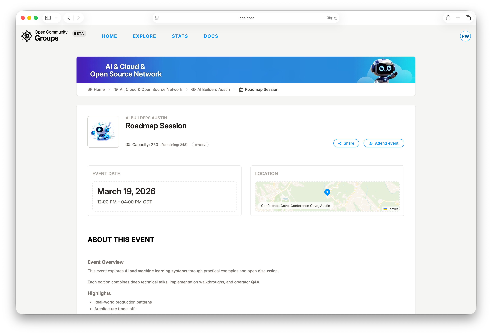

## Event-Day Checklist

?> Run this checklist shortly before start time to catch delivery issues early.

1. Confirm attendee table loads in the `Attendees` tab.
2. Open the Check-In scanner and confirm camera access.
3. Test one attendee QR code and the manual fallback.
4. Prepare attendee email template for urgent updates.
5. Re-verify schedule and meeting links before start.
